<div align="justify">

# Fonte de bancada regulável com ajuste e monitoramento digital

**Site do projeto:** [instruções de geração, prévia local e publicação no GitHub Pages](site/README.md).

Projeto de Trabalho de Conclusão de Curso em **Engenharia Elétrica**, desenvolvido por **Matheus Grossi** no **Centro Universitário Feitep — UniFeitep**, em Maringá, em 2024, sob orientação do **Esp. Sérgio Carlos da Silva**.

A proposta integra uma fonte de alimentação de bancada, circuitos de potência e uma interface com ESP32 e display TFT de 7 polegadas para ajustar a saída e apoiar os testes de circuitos eletrônicos. Este repositório reúne a monografia, os projetos eletrônicos, o firmware, os ensaios e os materiais utilizados no desenvolvimento.

<p align="center">
  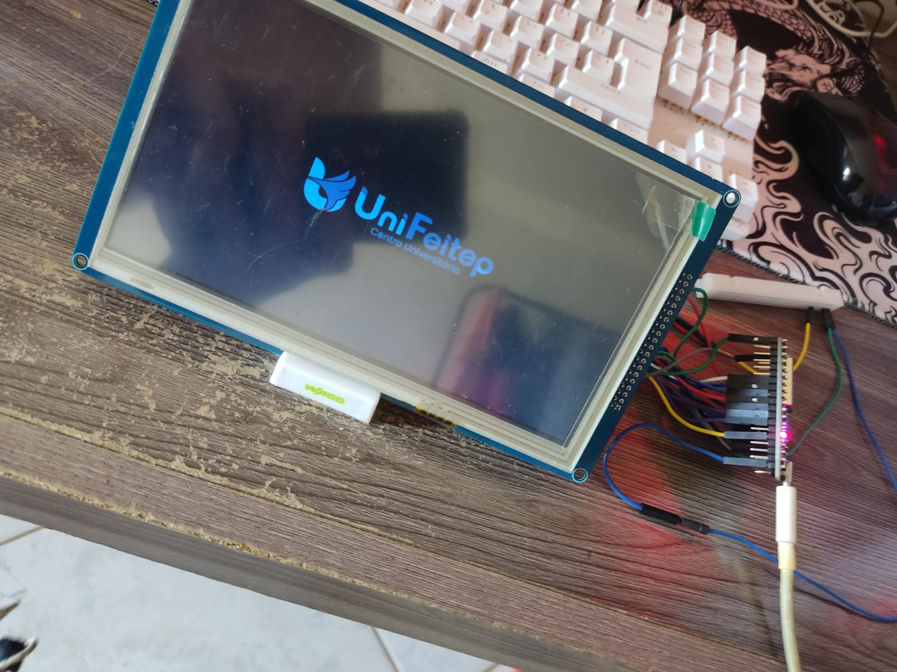
</p>

*Display do projeto com o logo da UniFeitep na tela de abertura.*

<p align="center">
  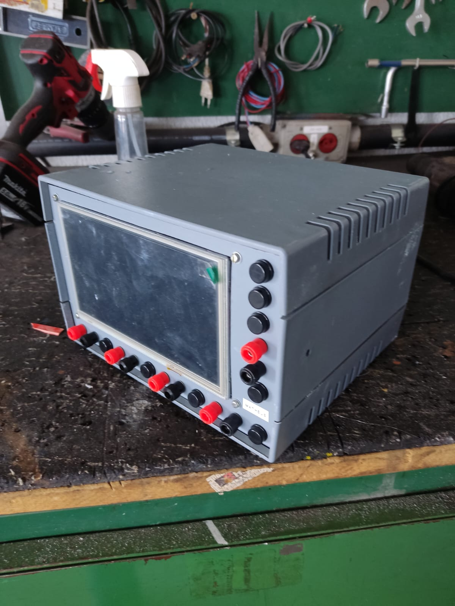
</p>

*Protótipo da fonte montado no gabinete, com display TFT, botões de comando e bornes de saída no painel frontal.*

<p align="center">
  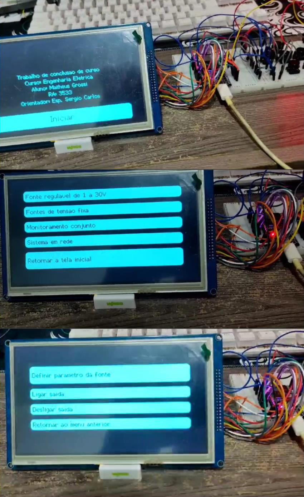
</p>

*Menus da fonte — Figura 48 da monografia, p. 67 (página 68 do PDF). Fonte: elaborado pelo autor (2024).*

**Acessos principais:** [Monografia em PDF](01_Texto_academico/Monografia/TCC%20Matheus%20Grossi-Rev.03-11-2024.pdf) · [Firmware selecionado](03_Firmware/final_version/final_version.ino) · [Esquemáticos](02_Hardware/Esquematicos) · [Renderizações das PCBs](02_Hardware/PCBs_render)

## Objetivo

Desenvolver uma fonte de bancada com ajuste e acompanhamento de funcionalidades por uma interface homem-máquina (IHM), utilizando display e botões físicos. O trabalho percorre o dimensionamento dos circuitos, a seleção de componentes, o desenho das placas, a acomodação dos circuitos e os testes em bancada.

A monografia apresenta como escopo uma saída principal ajustável de **0 a 40 V**, com capacidade prevista de **até 5 A**, e saídas auxiliares de **3,3 V, 5 V, 12 V e 24 V**, com até 5 A no conjunto. Esses valores descrevem o projeto; os ensaios de tensão publicados usam **32 V como referência máxima**.

## Arquitetura e hardware

O caminho de alimentação compreende entrada CA, transformador abaixador, retificação em ponte, filtragem capacitiva e regulação. O ESP32 gera o sinal PWM de controle e apresenta os menus no display.

<table align="center">
  <thead>
    <tr>
      <th align="center">Bloco</th>
      <th align="center">Solução descrita na monografia</th>
    </tr>
  </thead>
  <tbody>
    <tr>
      <td align="center">Transformação</td>
      <td align="center">Transformador com entrada 127/220 V e secundário de 32 VCA, 5 A</td>
    </tr>
    <tr>
      <td align="center">Retificação e filtragem</td>
      <td align="center">Ponte GBU1510 e banco de cinco capacitores de 1.000 µF / 63 V</td>
    </tr>
    <tr>
      <td align="center">Fonte principal</td>
      <td align="center">Regulador LM723 em configuração flutuante, com etapa externa de potência</td>
    </tr>
    <tr>
      <td align="center">Fontes auxiliares</td>
      <td align="center">Reguladores LM317, resistores e trimpots para definir as saídas</td>
    </tr>
    <tr>
      <td align="center">Potência e acionamento</td>
      <td align="center">TIP35C, BD139 e MOSFET IRLZ44N, conforme a etapa do circuito</td>
    </tr>
    <tr>
      <td align="center">Controle</td>
      <td align="center">ESP32, geração de PWM e comandos por botões</td>
    </tr>
    <tr>
      <td align="center">Interface</td>
      <td align="center">Display TFT de 7&quot;, 800 × 480 pixels, controlador SSD1963 e barramento paralelo de 8 bits</td>
    </tr>
  </tbody>
</table>

O display possui controlador de toque XPT2046, mas a implementação descrita no trabalho utiliza **botões físicos** para os comandos.

<p align="center">
  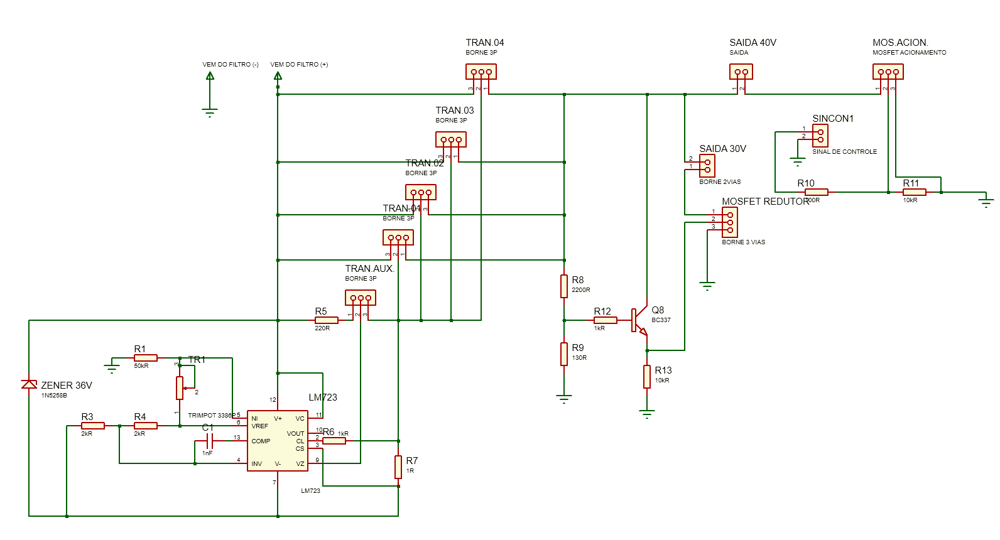
</p>

*Circuito principal — Figura 39 da monografia, p. 60. Fonte: elaborado pelo autor (2024).*

<p align="center">
  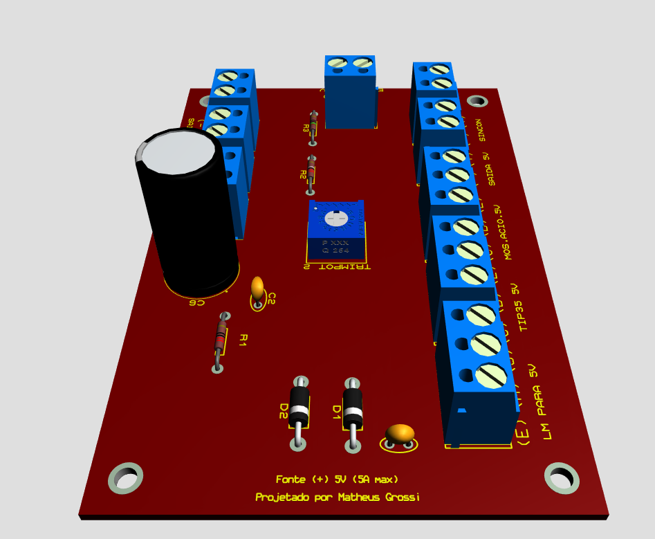
</p>

*Vista 3D da placa identificada como fonte de +5 V, disponível nos arquivos internos do projeto. A renderização representa o projeto da placa.*

Os desenhos complementares estão nas pastas [Esquematicos](02_Hardware/Esquematicos), [PCBs_render](02_Hardware/PCBs_render) e [Fabricacao_PCB](02_Hardware/Fabricacao_PCB). Os apêndices B a E da monografia apresentam os projetos das fontes auxiliares.

### Fontes de tensão fixa

Os apêndices B a E reúnem os esquemáticos e as vistas das placas das quatro fontes auxiliares. As imagens abaixo reproduzem as páginas completas do PDF; clique em cada uma para consultar os detalhes.

<table align="center">
  <thead>
    <tr>
      <th align="center">Fonte de 3,3 V</th>
      <th align="center">Fonte de 5 V</th>
    </tr>
  </thead>
  <tbody>
    <tr>
      <td align="center"><a href="00_Imagens/apendice_B_fonte_3v3.png">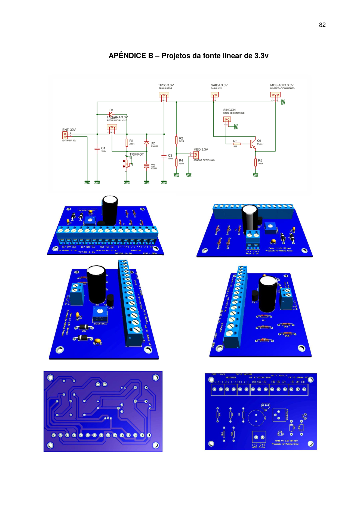</a></td>
      <td align="center"><a href="00_Imagens/apendice_C_fonte_5v.png">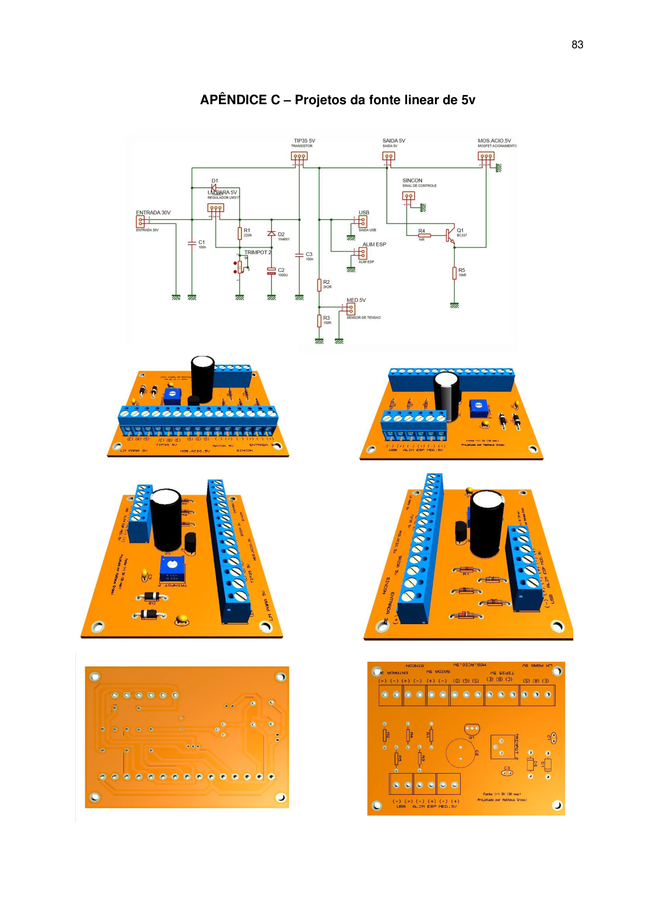</a></td>
    </tr>
    <tr>
      <td align="center">Apêndice B, p. 82.</td>
      <td align="center">Apêndice C, p. 83.</td>
    </tr>
  </tbody>
</table>

<table align="center">
  <thead>
    <tr>
      <th align="center">Fonte de 12 V</th>
      <th align="center">Fonte de 24 V</th>
    </tr>
  </thead>
  <tbody>
    <tr>
      <td align="center"><a href="00_Imagens/apendice_D_fonte_12v.png">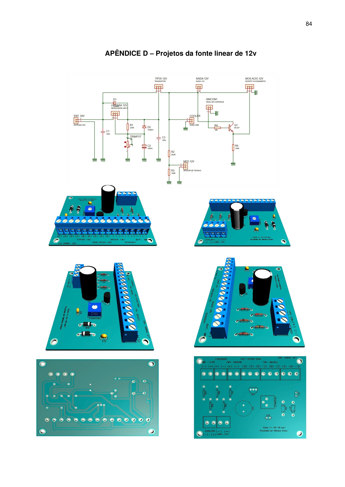</a></td>
      <td align="center"><a href="00_Imagens/apendice_E_fonte_24v.png">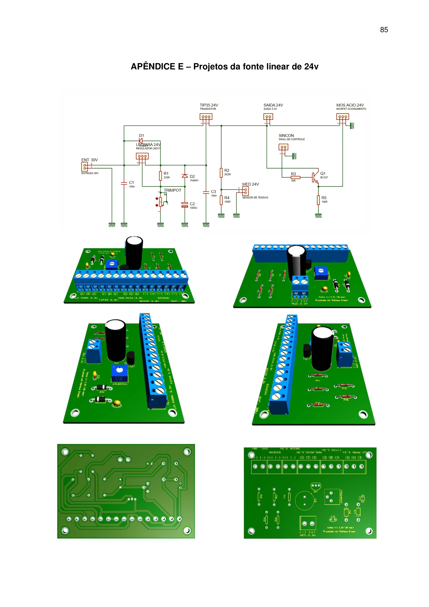</a></td>
    </tr>
    <tr>
      <td align="center">Apêndice D, p. 84.</td>
      <td align="center">Apêndice E, p. 85.</td>
    </tr>
  </tbody>
</table>

*Fonte: apêndices da monografia de Matheus Grossi (2024).*

### Fabricação e montagem das placas

As imagens a seguir registram o layout, a fabricação e a montagem das placas do projeto.

<p align="center">
  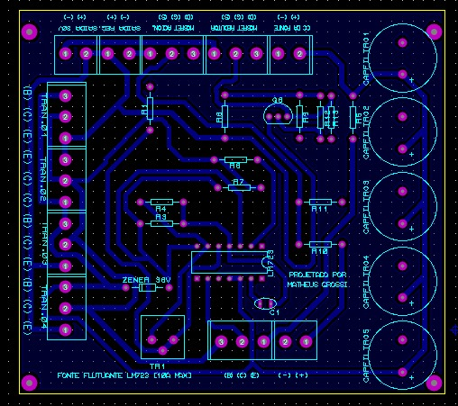
</p>

*Layout da PCB principal, com as trilhas, os pontos de conexão e a disposição dos componentes, incluindo o banco de cinco capacitores.*

<p align="center">
  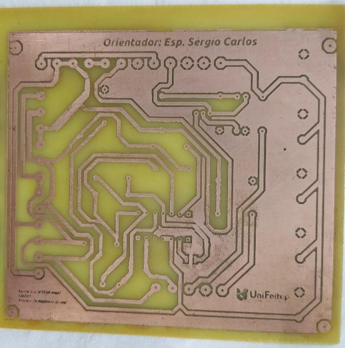
</p>

*Placa principal após a formação das trilhas de cobre, ainda sem os componentes, com identificação do projeto e o logo da UniFeitep.*

<p align="center">
  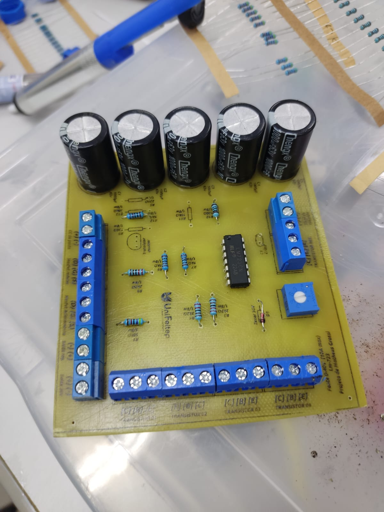
</p>

*Etapa de montagem da placa principal: banco de cinco capacitores eletrolíticos, regulador LM723, resistores, trimpot e bornes de conexão.*

<p align="center">
  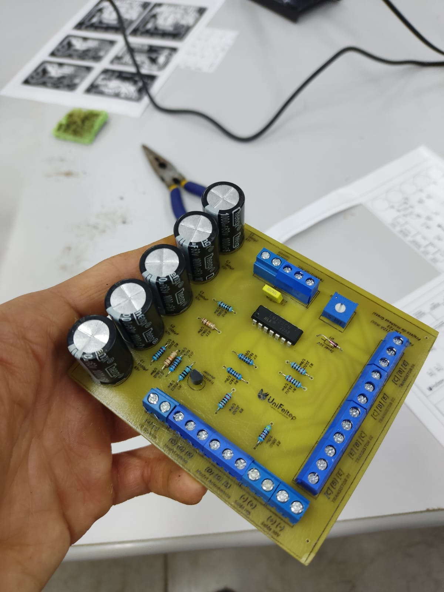
</p>

*Outra vista da placa principal, mostrando os componentes instalados e os bornes destinados às conexões com os demais elementos da fonte.*

<p align="center">
  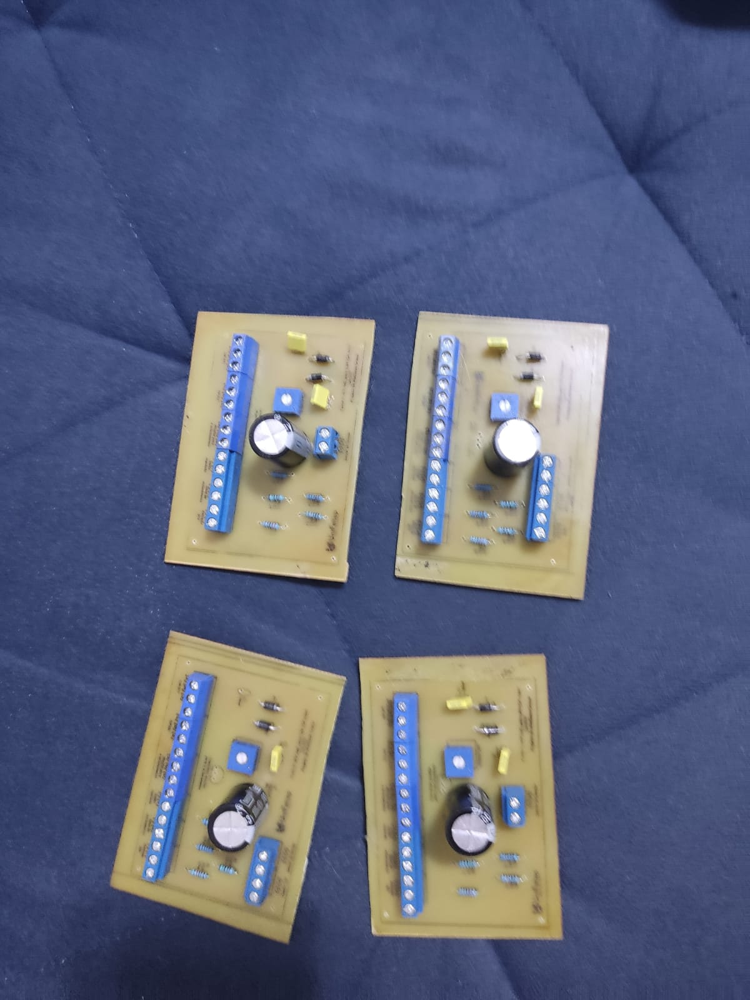
</p>

*Quatro placas das fontes auxiliares durante a montagem, com capacitores, resistores, diodos, trimpots e bornes de conexão.*

## Interface e firmware

### Pinagem da interface do display

As tabelas abaixo reproduzem as conexões entre o SSD1963 e o ESP32 apresentadas nas Figuras 43, 44 e 45 da monografia, p. 64 (página 65 do PDF). A interface de imagem utiliza comunicação paralela de **8 bits**.

**Barramento de dados — Figura 43**

<table align="center">
  <thead>
    <tr>
      <th align="center">Pino do SSD1963</th>
      <th align="center">Pino do ESP32</th>
    </tr>
  </thead>
  <tbody>
    <tr>
      <td align="center">D0</td>
      <td align="center">GPIO 12</td>
    </tr>
    <tr>
      <td align="center">D1</td>
      <td align="center">GPIO 13</td>
    </tr>
    <tr>
      <td align="center">D2</td>
      <td align="center">GPIO 26</td>
    </tr>
    <tr>
      <td align="center">D3</td>
      <td align="center">GPIO 25</td>
    </tr>
    <tr>
      <td align="center">D4</td>
      <td align="center">GPIO 17</td>
    </tr>
    <tr>
      <td align="center">D5</td>
      <td align="center">GPIO 16</td>
    </tr>
    <tr>
      <td align="center">D6</td>
      <td align="center">GPIO 27</td>
    </tr>
    <tr>
      <td align="center">D7</td>
      <td align="center">GPIO 14</td>
    </tr>
  </tbody>
</table>

**Alimentação — Figura 44**

<table align="center">
  <thead>
    <tr>
      <th align="center">Pino do SSD1963</th>
      <th align="center">Pino do ESP32</th>
    </tr>
  </thead>
  <tbody>
    <tr>
      <td align="center">5V</td>
      <td align="center">5V</td>
    </tr>
    <tr>
      <td align="center">3.3V</td>
      <td align="center">3.3V</td>
    </tr>
    <tr>
      <td align="center">LED_A</td>
      <td align="center">5V</td>
    </tr>
    <tr>
      <td align="center">GND</td>
      <td align="center">GND</td>
    </tr>
  </tbody>
</table>

A monografia esclarece, na p. 65, que a alimentação do display pode ser fornecida por uma fonte externa, sem depender dos pinos de alimentação do ESP32.

**Sinais de controle — Figura 45**

<table align="center">
  <thead>
    <tr>
      <th align="center">Pino do SSD1963</th>
      <th align="center">Pino do ESP32</th>
    </tr>
  </thead>
  <tbody>
    <tr>
      <td align="center">CS</td>
      <td align="center">GPIO 33</td>
    </tr>
    <tr>
      <td align="center">RS</td>
      <td align="center">GPIO 15</td>
    </tr>
    <tr>
      <td align="center">RESET</td>
      <td align="center">GPIO 32</td>
    </tr>
    <tr>
      <td align="center">WR</td>
      <td align="center">GPIO 04</td>
    </tr>
    <tr>
      <td align="center">RD</td>
      <td align="center">GPIO 02</td>
    </tr>
  </tbody>
</table>

*Fonte: elaborado pelo autor (2024), conforme as Figuras 43 a 45 da monografia. Estas tabelas documentam a interface descrita no trabalho; a configuração do firmware selecionado deve ser conferida ao retomar o projeto.*

### Firmware selecionado

A versão separada para continuidade do projeto está em [03_Firmware/final_version](03_Firmware/final_version):

```text
final_version/
├── final_version.ino
├── alert.h
└── logofeitep.h
```

O sketch usa a biblioteca **TFT_eSPI** e reúne a tela de abertura, os menus, o ajuste do duty cycle e os comandos para ligar e desligar a saída PWM.

<table align="center">
  <thead>
    <tr>
      <th align="center">Função no firmware selecionado</th>
      <th align="center">Configuração</th>
    </tr>
  </thead>
  <tbody>
    <tr>
      <td align="center">Subir / aumentar o ajuste</td>
      <td align="center">GPIO 22</td>
    </tr>
    <tr>
      <td align="center">Descer / diminuir o ajuste</td>
      <td align="center">GPIO 18</td>
    </tr>
    <tr>
      <td align="center">Confirmar</td>
      <td align="center">GPIO 19</td>
    </tr>
    <tr>
      <td align="center">Saída PWM</td>
      <td align="center">GPIO 5</td>
    </tr>
    <tr>
      <td align="center">Frequência PWM</td>
      <td align="center">5 kHz</td>
    </tr>
    <tr>
      <td align="center">Resolução PWM</td>
      <td align="center">12 bits, de 0 a 4095</td>
    </tr>
  </tbody>
</table>

<p align="center">
  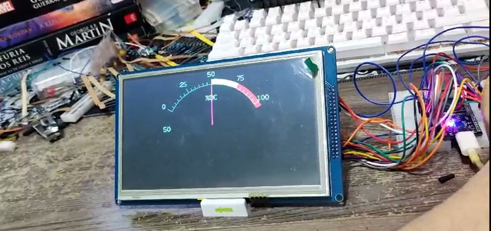
</p>

*Registro de bancada de outubro de 2024: a interface mostra o indicador de duty cycle em 50%. A foto documenta essa etapa do desenvolvimento.*

### Estado do código disponível

A monografia descreve PWM de **10 bits** e um painel de navegação com **cinco botões**. O firmware selecionado, cujo arquivo tem modificação registrada em **13/12/2024**, usa **12 bits** e **três botões**. Assim, o código e os registros da monografia representam etapas diferentes do desenvolvimento.

No sketch selecionado:

- O controle da saída PWM e o ajuste do duty cycle estão implementados.
- A opção de monitoramento aparece no menu, mas não possui ação implementada.
- A função de rede simula a conexão Wi-Fi por mensagens na tela.
- O submenu de fontes fixas ainda não implementa o acionamento individual das saídas.

O nome `final_version` identifica a versão selecionada para o projeto. A compilação e o funcionamento no protótipo não foram revalidados durante a organização destes arquivos.

### Para retomar o desenvolvimento

1. Abra [final_version.ino](03_Firmware/final_version/final_version.ino) no ambiente Arduino/ESP32, mantendo os dois cabeçalhos na mesma pasta.
2. Confira o modelo da placa, as conexões do protótipo e a configuração da biblioteca TFT_eSPI. O arquivo [Configuracao_TFT_eSPI_a_revisar.h](03_Firmware/Configuracoes/Configuracao_TFT_eSPI_a_revisar.h) é uma referência a revisar: contém definições de ILI9341 e não deve ser tratado como configuração validada para o SSD1963.
3. Consulte a seção 3.14 da monografia para o barramento do display e compare-a com a montagem existente.
4. Registre as versões das ferramentas e bibliotecas usadas ao compilar e os resultados dos novos ensaios.

As variantes anteriores permanecem em [Fonte_de_bancada](03_Firmware/Fonte_de_bancada), e os testes isolados estão em [Experimentos](03_Firmware/Experimentos).

## Resultados registrados na monografia

Os três ensaios do capítulo 4 comparam a tensão medida com a tensão esperada para uma referência máxima de 32 V.

<table align="center">
  <thead>
    <tr>
      <th align="center">Ajuste</th>
      <th align="center">Tensão esperada</th>
      <th align="center">Tensão medida</th>
      <th align="center">Desvio relativo</th>
    </tr>
  </thead>
  <tbody>
    <tr>
      <td align="center">10%</td>
      <td align="center">3,2 V</td>
      <td align="center">2,9 V</td>
      <td align="center">−9,4%</td>
    </tr>
    <tr>
      <td align="center">50%</td>
      <td align="center">16,0 V</td>
      <td align="center">17,0 V</td>
      <td align="center">+6,25%</td>
    </tr>
    <tr>
      <td align="center">100%</td>
      <td align="center">32,0 V</td>
      <td align="center">31,9 V</td>
      <td align="center">−0,31%</td>
    </tr>
  </tbody>
</table>

*Fonte: monografia, seções 4.1 a 4.3, pp. 70–72. Desvios arredondados conforme o texto.*

Os resultados mostram diferenças entre o ajuste e a tensão obtida, motivando a calibração da relação entre duty cycle e saída. Esses três pontos não comprovam toda a faixa de 0 a 40 V nem a capacidade de corrente sob carga. A seção 3.11 também menciona dimensionamento de 10 A para a etapa principal, enquanto a seção 3.3 e o transformador indicam 5 A; a capacidade efetiva precisa ser consolidada com o dimensionamento e os ensaios de carga.

As [fotografias](00_Imagens), os [vídeos](05_Ensaios_e_resultados/Videos) e as [planilhas](05_Ensaios_e_resultados/Planilhas) preservam os registros disponíveis.

### Imagens dos testes em bancada

<table align="center">
  <thead>
    <tr>
      <th align="center">Teste 1 — ajuste de 10%</th>
      <th align="center">Teste 2 — ajuste de 50%</th>
      <th align="center">Teste 3 — ajuste de 100%</th>
    </tr>
  </thead>
  <tbody>
    <tr>
      <td align="center"><a href="00_Imagens/figura_51_teste_10_porcento.png">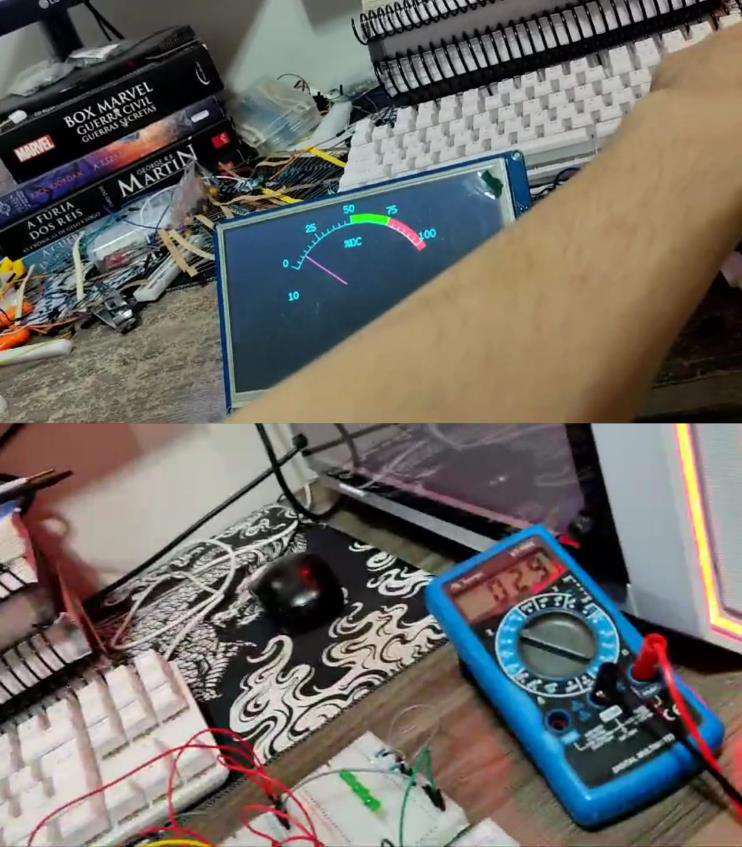</a></td>
      <td align="center"><a href="00_Imagens/figura_52_teste_50_porcento.png">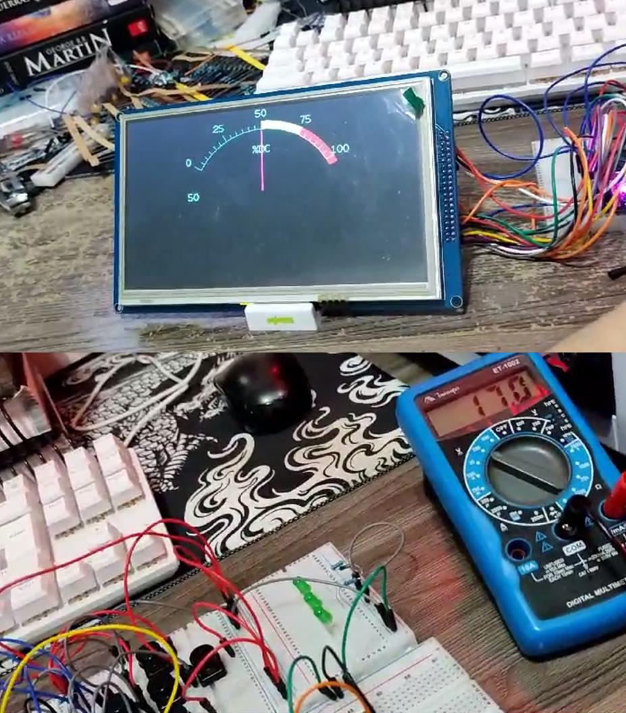</a></td>
      <td align="center"><a href="00_Imagens/figura_53_teste_100_porcento.png">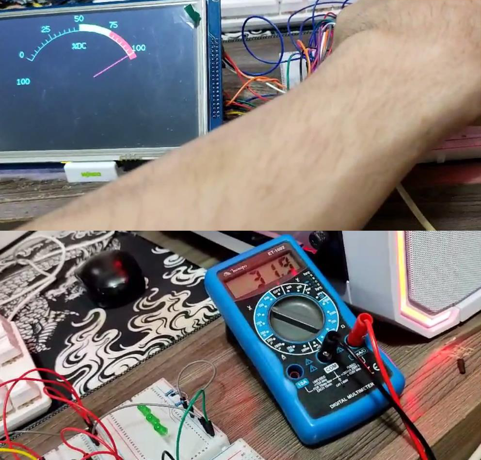</a></td>
    </tr>
    <tr>
      <td align="center">Esperado: <strong>3,2 V</strong>. Medido: <strong>2,9 V</strong>.</td>
      <td align="center">Esperado: <strong>16 V</strong>. Medido: <strong>17 V</strong>.</td>
      <td align="center">Esperado: <strong>32 V</strong>. Medido: <strong>31,9 V</strong>.</td>
    </tr>
    <tr>
      <td align="center">Figura 51, p. 70.</td>
      <td align="center">Figura 52, p. 71.</td>
      <td align="center">Figura 53, p. 72.</td>
    </tr>
  </tbody>
</table>

*Fonte: elaborado pelo autor (2024), conforme as legendas da monografia. Clique nas imagens para ampliá-las.*

### Vídeos dos testes em bancada

Os cinco registros em vídeo disponíveis na pasta [05_Ensaios_e_resultados/Videos](05_Ensaios_e_resultados/Videos) estão relacionados abaixo. Os identificadores seguem a ordem dos arquivos; os nomes disponíveis não especificam o ajuste de tensão de cada ensaio.

<table align="center">
  <thead>
    <tr>
      <th align="center">Registro</th>
      <th align="center">Arquivo do vídeo</th>
    </tr>
  </thead>
  <tbody>
    <tr>
      <td align="center">Teste em bancada — vídeo 01</td>
      <td align="center"><a href="05_Ensaios_e_resultados/Videos/2024-10-20_213115_registro_video_01.mp4">2024-10-20_213115_registro_video_01.mp4</a></td>
    </tr>
    <tr>
      <td align="center">Teste em bancada — vídeo 02</td>
      <td align="center"><a href="05_Ensaios_e_resultados/Videos/2024-10-20_213118_registro_video_01.mp4">2024-10-20_213118_registro_video_01.mp4</a></td>
    </tr>
    <tr>
      <td align="center">Teste em bancada — vídeo 03</td>
      <td align="center"><a href="05_Ensaios_e_resultados/Videos/2024-10-20_213118_registro_video_02.mp4">2024-10-20_213118_registro_video_02.mp4</a></td>
    </tr>
    <tr>
      <td align="center">Teste em bancada — vídeo 04</td>
      <td align="center"><a href="05_Ensaios_e_resultados/Videos/2024-10-20_213121_registro_video_01.mp4">2024-10-20_213121_registro_video_01.mp4</a></td>
    </tr>
    <tr>
      <td align="center">Teste em bancada — vídeo 05</td>
      <td align="center"><a href="05_Ensaios_e_resultados/Videos/2024-10-20_213121_registro_video_02.mp4">2024-10-20_213121_registro_video_02.mp4</a></td>
    </tr>
  </tbody>
</table>

## Continuidade do projeto

A conclusão e a discussão do trabalho apontam possibilidades de evolução:

- Calibrar a relação entre PWM e tensão, com apresentação do ajuste em volts.
- Integrar sensores de corrente e a definição de limite de corrente.
- Implementar desarme por sobrecarga ou curto-circuito.
- Integrar medição de temperatura e ações de proteção térmica.

No firmware disponível, também permanecem pendentes o monitoramento, o controle individual das fontes fixas e a conexão de rede real.

## Organização dos arquivos

<table align="center">
  <thead>
    <tr>
      <th align="center">Pasta</th>
      <th align="center">Conteúdo</th>
    </tr>
  </thead>
  <tbody>
    <tr>
      <td align="center"><a href="00_Imagens">00_Imagens</a></td>
      <td align="center">Imagens utilizadas neste README: figuras da monografia, fotos e renderizações das placas</td>
    </tr>
    <tr>
      <td align="center"><a href="01_Texto_academico">01_Texto_academico</a></td>
      <td align="center">Monografia, revisões anteriores e apresentações</td>
    </tr>
    <tr>
      <td align="center"><a href="02_Hardware">02_Hardware</a></td>
      <td align="center">Projetos do Proteus, esquemáticos, renderizações e arquivos de fabricação</td>
    </tr>
    <tr>
      <td align="center"><a href="03_Firmware">03_Firmware</a></td>
      <td align="center">Versão selecionada, variantes, experimentos e configurações</td>
    </tr>
    <tr>
      <td align="center"><a href="04_Interface_grafica">04_Interface_grafica</a></td>
      <td align="center">Projeto de IHM, logos, artes e fontes tipográficas</td>
    </tr>
    <tr>
      <td align="center"><a href="05_Ensaios_e_resultados">05_Ensaios_e_resultados</a></td>
      <td align="center">Fotos, vídeos, planilhas e registros de simulação</td>
    </tr>
    <tr>
      <td align="center"><a href="06_Referencias">06_Referencias</a></td>
      <td align="center">Datasheets, manuais e exemplos de apoio</td>
    </tr>
    <tr>
      <td align="center"><a href="07_Dependencias">07_Dependencias</a></td>
      <td align="center">Bibliotecas de Arduino e Proteus</td>
    </tr>
    <tr>
      <td align="center"><a href="99_Historico">99_Historico</a></td>
      <td align="center">Backups, projetos anteriores e ferramentas preservadas</td>
    </tr>
  </tbody>
</table>

## Documento e imagens de referência

**GROSSI, Matheus.** *Projeto e construção de uma fonte de bancada regulável com ajuste e monitoramento digital*. Trabalho de Conclusão de Curso em Engenharia Elétrica — Centro Universitário Feitep, Maringá, 2024.

Este README foi elaborado a partir do [PDF da monografia](01_Texto_academico/Monografia/TCC%20Matheus%20Grossi-Rev.03-11-2024.pdf), do firmware selecionado e dos arquivos internos. As páginas citadas seguem a numeração impressa do documento.

As figuras 39, 48, 51, 52 e 53 foram extraídas do PDF e são creditadas ao autor na monografia. As páginas dos apêndices B a E foram renderizadas para apresentar os projetos completos das fontes fixas. As demais imagens são registros e renderizações presentes no projeto. As imagens utilizadas neste README estão reunidas na pasta [00_Imagens](00_Imagens).

</div>
